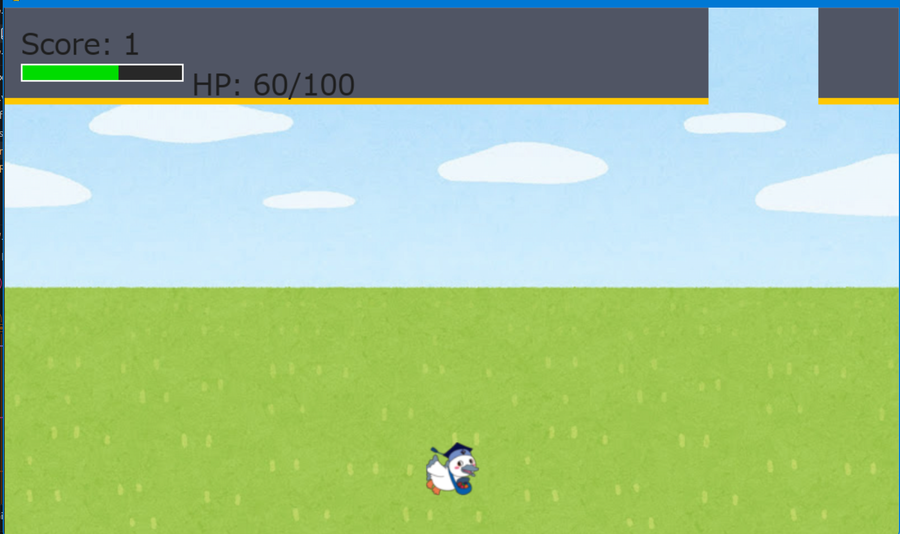
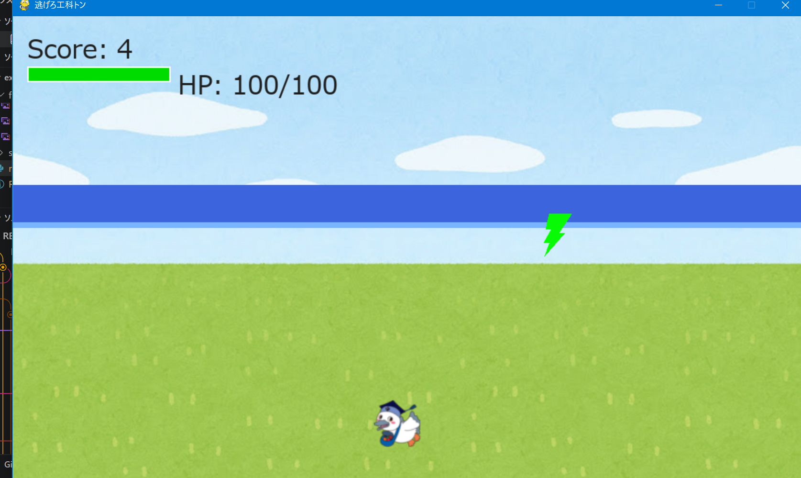

# 逃げろ工科トン

## 実行環境の必要条件
* python >= 3.10
* pygame >= 2.1

* 必要なものがあれば追記してください（非推奨）

## ゲームの概要
* 舞台は、レンガ造りの時計塔と最先端の研究施設が立ち並ぶ工学キャンパス。
ある日の放課後、キャンパス中央の実験棟で開発中だった「自動建設・耐久試験システム」のAIが突然暴走！
システムが誤作動を起こしたことで、巨大な「プレス機」がキャンパスの空から次々と落下してくる緊急事態が発生した。   運悪く中庭にいたこうかとんは、逃げ場を失いながらも持ち前のフットワークでプレス機をかわし続けることに。果たしてこうかとんは、研究員たちがシステムを停止させるまで生き残ることができるのか――！？
* 参考URL：[迫りくる天井から逃げ回れ。スマホ向けアプリ「ExitMan - 瞬間回避ゲーム」を紹介する「（ほぼ）日刊スマホゲーム通信」](https://www.4gamer.net/games/560/G056032/20210322001/)

## ゲームの遊び方
* 左右の矢印キーを使って迫ってくる天井を避け続ける
* 潰れたらゲームオーバー
* 避けた天井の回数を競うゲーム！
* 黒い天井は凹んでいる場所に逃げる！
* 赤い天井はしゃがんで回避！
* 青い天井はタイミングよくジャンプ！
* 落ちてくるアイテムに触れるとキャラクターが無敵になったり体力が増えたりするよ！

* 操作方法
W/↑/SPACE　ジャンプ
→/D  右移動
←/A　左移動
↓/S　下移動
Shift ダッシュ

## ゲームの実装

### 共通基本機能
* 背景画像と主人公キャラクターの描画
* 左右に動く機能・ダッシュ機能・落下してくる黒い天井
### 分担追加機能
* アイテムシステム（担当：孫 鵬斐 ）
    ゲーム中にランダムでアイテムが出現する機能を実装した。
    赤色アイテムを取得するとHPが10回復する。

    黄色アイテムを取得すると3秒間無敵状態になる。

    緑色アイテムを取得すると5秒間移動速度が上昇する。
    紫色アイテムを取得すると5秒間こうかとんが小さくなる。

    アイテムごとに異なる色を設定し、効果を分かりやすくした。
* HP処理の実装(呉博軒)
* スタート画面　ゲームオーバー画面　キャラクター選択　キャラクター事に操作をつけるのではなく今後キャラクター追加しやすいようにキャラクター基本機能と別にコーディングしたC0A25043 大河内爽来
* サウンド,BGM実装 C0A25243　森田克樹
* 落ちてくる天井の設定 * Wキー/↑キー/Spaceキーによるジャンプ機能の実装。
* Sキー/↓キーによるしゃがみ機能の実装。C0A25071　金山翔璃

### メモ
しゃがみとジャンプを使って避けるような障害物を追加予定
複数のキャラクターを作りたかった
壁の速度アップ　難易度の変化が欲しかった
